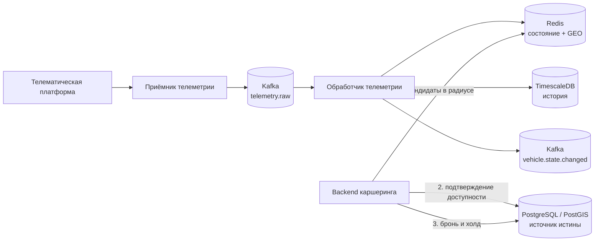

# Доклад: Redis — кэширование и паттерны кэширования

Материалы к внутреннему техническому митапу: презентация и текст доклада о применении **Redis** в проекте **«Система каршеринга»**.

Задание: [SA-2377](https://javacode.atlassian.net/browse/SA-2377) — «Подготовка презентации по изученной технологии».

## Состав репозитория

| Файл | Что это |
|---|---|
| [`doklad.md`](doklad.md) | Полный текст доклада: задача, выбор технологии, теория, кейс, результаты, трудности, рекомендации |
| [`presentation/redis-caching-carsharing.pptx`](presentation/redis-caching-carsharing.pptx) | Презентация, 12 слайдов (PowerPoint) |
| [`presentation/redis-caching-carsharing.pdf`](presentation/redis-caching-carsharing.pdf) | Та же презентация в PDF |
| `README.md` | Этот файл: навигация и блок «Описание значимости артефакта» |

## О чём доклад

1. **Задача на проекте.** Каршеринг: до 10 000 автомобилей, до 3 000 активных поездок, до 5 000 броней; бронь — не более 3 секунд в 95% случаев. Позиции машин обновляются потоком телеметрии, а поиск ближайших выполняется на каждый запрос клиента.
2. **Почему Redis.** In-memory чтение, гео-команды для поиска по радиусу, общий слой для всех инстансов Backend, TTL, восстановимый индекс.
3. **Как применено.** Телеметрия → Kafka → обработчик → Redis (состояние + GEO) и TimescaleDB (история); Backend читает Redis GEO для кандидатов и подтверждает доступность транзакционно в PostgreSQL.
4. **Граница ответственности.** Redis ускоряет чтение, но не является источником истины: бронь, геозоны и деньги проверяются в PostgreSQL/PostGIS.
5. **Результаты и ограничения.** Что даёт решение и какие трудности остаются: консистентность, расчёт TTL, холодный старт, память, отладка.
6. **Рекомендации.** Когда Redis уместен на финтех-проектах, когда — нет, и чек-лист перед внедрением.

## Схема решения

Ключевое: Redis отвечает на вопрос «кто рядом», а не «кому можно продать».

## Описание значимости артефакта

| Раздел | Содержание |
|---|---|
| **Процесс и контекст использования** | Внутренний технический митап по обмену опытом между командами. Артефакт применяется на этапе, когда технология уже выбрана и применена в проекте, и опыт нужно передать коллегам, а также зафиксировать для базы знаний. |
| **Цель создания** | Объяснить команде, не знакомой с технологией, что такое Redis и паттерны кэширования; показать, почему в проекте «Система каршеринга» выбрано именно это решение; зафиксировать границы его применимости и условия, при которых кэш безопасен. |
| **Что становится определено** | Название технологии (Redis) и выбранный паттерн (кэш как проекция источника истины + Cache-Aside); граница ответственности: Redis — производный восстанавливаемый индекс, источник истины — PostgreSQL/PostGIS; требования к TTL и инвалидации; поведение при отказе или потере кэша; критерии применимости на других финтех-проектах. |
| **Пользователи артефакта** | Команда разработки и аналитики проекта; новые сотрудники, вводящиеся в проект; ментор и участники митапа; команды других проектов, оценивающие кэширование. Используют как объяснение решения, как ориентир при ревью архитектуры и как отправную точку для собственных оценок. |
| **Использование в дальнейшем** | Материалы публикуются в Confluence (макрос MacroPack, Markdown-разметка) и служат страницей базы знаний по кэшированию; решение переиспользуется как шаблон оценки Redis на новых проектах; зафиксированные пробелы (расчёт TTL, замеры hit ratio и латентности, стратегия прогрева) становятся входом для нагрузочного тестирования. |
| **Последствия отсутствия** | Решение о выборе Redis и его границы остаются неявными и уходят вместе с участниками команды; повторяются типовые ошибки — кэш как источник истины, необоснованный TTL, отсутствие перепроверки перед бронированием; у новых проектов нет критериев, когда кэш уместен, а когда создаёт регуляторные и финансовые риски. |

## Источники

- [SA-2377](https://javacode.atlassian.net/browse/SA-2377) — задание на презентацию.
- [SA-2272](https://javacode.atlassian.net/browse/SA-2272) — Vision проекта «Система каршеринга».
- [SA-2273](https://javacode.atlassian.net/browse/SA-2273) — BRD: нагрузка и бизнес-ожидания.
- [SA-2274](https://javacode.atlassian.net/browse/SA-2274) — C4-архитектура: Redis + GEO.
- [SA-2275](https://javacode.atlassian.net/browse/SA-2275) — декомпозиция задач.

## Ограничения материалов

- Проект учебный: измеримых production-метрик («до/после») нет. Это явно зафиксировано в докладе; эффекты описаны как проектные ожидания.
- Количественные показатели нагрузки взяты из BRD и являются проектными допущениями учебного сценария.
- Конкретные значения TTL и формат ключей в архитектуре не зафиксированы — обозначены как требующие нагрузочного расчёта.
