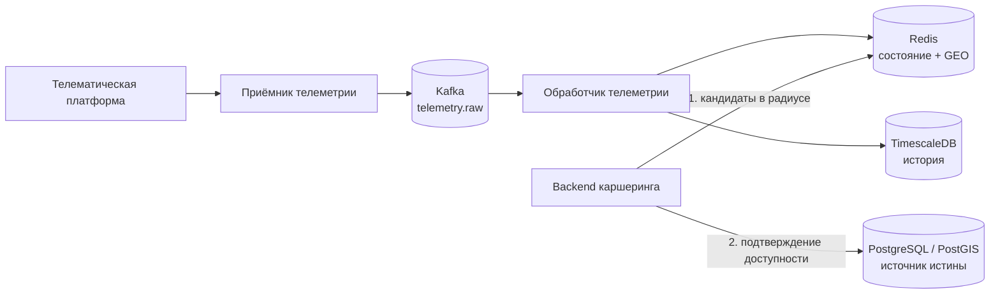

# Доклад: Redis — кэширование, инвалидация, персистентность

Материалы к задаче [SA-2377](https://javacode.atlassian.net/browse/SA-2377) «Подготовка презентации по изученной технологии».

Доклад и презентация — авторские, публикуются **без изменений**. Дополнительно добавлен раздел о практическом применении Redis (Redis GEO) на проекте «Система каршеринга».

## Состав

| Файл | Что это |
|---|---|
| [`doklad/Презентация кеширование+редис.docx`](doklad/Презентация%20кеширование%2Bредис.docx) | Текст доклада — исходный файл, без изменений |
| [`presentation/Презентация кэширования.pptx`](presentation/Презентация%20кэширования.pptx) | Презентация, 10 слайдов — исходный файл, без изменений |
| [`presentation/Презентация кэширования + кейс каршеринга.pptx`](presentation/Презентация%20кэширования%20%2B%20кейс%20каршеринга.pptx) | Та же презентация + 2 слайда про Redis GEO (12 слайдов), в том же шаблоне |
| [`kejs-karshering.md`](kejs-karshering.md) | Текст раздела про применение Redis GEO на проекте каршеринга — для вставки в доклад |

## Что добавлено к исходным материалам

Исходные доклад и презентация описывают технологию в общем виде: кэширование, уровни, стратегии, инвалидация, персистентность, Redis. По условиям задачи в материалах не хватало привязки к реальному проекту.

Добавлен один блок — **практическое применение Redis (Redis GEO) в проекте «Система каршеринга»**:

- какую задачу решала команда и почему выбрала Redis;
- как устроен поток телеметрии и геопоиск;
- почему кэш не стал источником истины;
- результаты, ограничения и рекомендации.

Оформление: текстовый раздел в `kejs-karshering.md` и два готовых слайда в дополненной версии презентации.

## Кейс: Redis GEO в проекте «Система каршеринга»

**Задача.** До 10 000 автомобилей, до 3 000 одновременно активных поездок, до 5 000 активных броней; подтверждение или отказ по брони — не более 3 секунд в 95% штатных случаев (BRD, SA-2273). Позиции автомобилей обновляются потоком телеметрии, а поиск ближайших машин — это геопоиск на каждый запрос клиента.

**Почему Redis.** В архитектуре (SA-2274) зафиксировано: Redis + GEO — быстрый слой текущего состояния и геопоиска. Он даёт чтение за миллисекунды, гео-команды для поиска по радиусу, общий слой состояния для всех инстансов Backend, встроенный TTL и восстановимость (индекс пересобирается из потока). Прямой геопоиск в PostgreSQL/PostGIS конкурировал бы с транзакциями брони и оплаты.

**Как устроено.**

**Границы.** Redis — производный восстанавливаемый индекс, а не источник истины: доступность автомобиля подтверждается транзакционно в PostgreSQL, геозоны проверяются в PostGIS, обработчик телеметрии идемпотентен. Redis отвечает на вопрос «кто рядом», а не «кому можно продать».

**Результаты и ограничения.** Геопоиск разгрузил PostGIS, появился единый слой реального времени, создан запас под требование к брони. Остались ограничения: отставание кэша от базы, необходимость расчёта TTL, холодный старт после потери кэша, память и стоимость, сложность отладки. Измеримых production-метрик нет — проект учебный.

## Описание значимости артефакта

| Раздел | Содержание |
|---|---|
| **Процесс и контекст использования** | Внутренний технический митап по обмену опытом. Артефакт применяется на этапе, когда технология уже выбрана и применена в проекте, а опыт нужно передать коллегам и зафиксировать для базы знаний. |
| **Цель создания** | Объяснить команде, не знакомой с технологией, что такое Redis и паттерны кэширования; показать, почему в проекте «Система каршеринга» выбрано именно это решение; зафиксировать границы применимости и условия, при которых кэш безопасен. |
| **Что становится определено** | Название технологии (Redis) и выбранный паттерн (кэш как проекция источника истины + Cache-Aside); граница ответственности: Redis — производный восстанавливаемый индекс, источник истины — PostgreSQL/PostGIS; требования к TTL и инвалидации; поведение при потере кэша; критерии применимости на других финтех-проектах. |
| **Пользователи артефакта** | Команда разработки и аналитики проекта; новые сотрудники; ментор и участники митапа; команды других проектов, оценивающие кэширование. Используют как объяснение решения и ориентир при ревью архитектуры. |
| **Использование в дальнейшем** | Публикация в Confluence (макрос MacroPack, Markdown) как страница базы знаний по кэшированию; шаблон оценки Redis на новых проектах; зафиксированные пробелы (расчёт TTL, замеры hit ratio и латентности, стратегия прогрева) становятся входом для нагрузочного тестирования. |
| **Последствия отсутствия** | Решение о выборе Redis и его границы остаются неявными и уходят вместе с участниками команды; повторяются типовые ошибки — кэш как источник истины, необоснованный TTL, отсутствие перепроверки перед бронированием; у новых проектов нет критериев, когда кэш уместен, а когда создаёт финансовые и регуляторные риски. |

## Источники

- [SA-2377](https://javacode.atlassian.net/browse/SA-2377) — задание на презентацию.
- [SA-2272](https://javacode.atlassian.net/browse/SA-2272) — Vision проекта «Система каршеринга».
- [SA-2273](https://javacode.atlassian.net/browse/SA-2273) — BRD: нагрузка и бизнес-ожидания.
- [SA-2274](https://javacode.atlassian.net/browse/SA-2274) — C4-архитектура: Redis + GEO.
- [SA-2275](https://javacode.atlassian.net/browse/SA-2275) — декомпозиция задач.
- Redis GEO: <https://redis.io/docs/latest/develop/data-types/geospatial/>

## Ограничения

- Доклад и презентация публикуются в авторской редакции; раздел про каршеринг — добавление поверх них.
- Проект учебный: измеримых production-метрик нет, эффекты описаны как проектные ожидания.
- Количественные показатели нагрузки взяты из BRD и являются проектными допущениями учебного сценария.
- Конкретные значения TTL и формат ключей в архитектуре не зафиксированы — обозначены как требующие нагрузочного расчёта.
